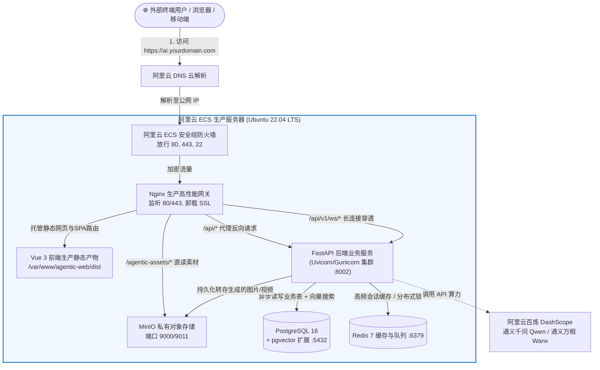
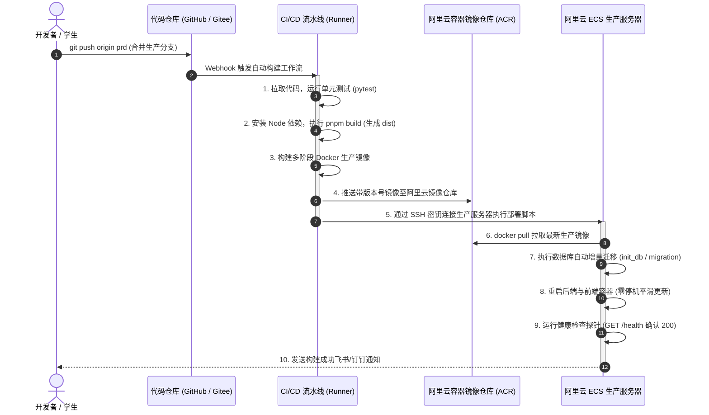

# AgenticCommerce 阿里云生产发布与部署全景指南

> **适用对象**：具备基础开发能力、准备将项目正式推向生产上线的开发者、运维工程师及高校师生。  
> **核心目标**：从 0 开始手把手教学，覆盖从**阿里云 ECS 服务器采购选型**、**安全组与网络配置**、**Python/前端/Docker 多维度打包**、**原生部署与容器化部署双方案**、**GitHub Actions / 阿里云云效 CI/CD 自动化流水线**，一直到**域名解析与免费 SSL 证书开启**的完整工业级交付闭环。

---

## 目录导航与学习路径

整个发布部署套件已系统化拆解为以下核心模块，请根据实际业务模式查阅：

```
docs/bushu/
├── 00_阿里云生产部署导航与架构全景.md       <-- [当前文件] 全景架构拓扑与部署方案选型对比
├── 01_阿里云ECS云服务器选购与环境初始化SOP.md <-- 购买服务器、安全组放行、系统初始化与Swap防OOM
├── 02_生产级打包全流程实操与脚本.md         <-- Python build、Npm build、Docker build 与离线镜像包制作
├── 03_方案A_原生裸机全流程部署实战.md       <-- 不用Docker：Systemd多进程守护 + Nginx高性能反代
├── 04_方案B_Docker容器化一键生产部署.md     <-- 全栈容器化：Docker Compose生产编排与零停机发布
├── 05_CI_CD自动化打包与持续部署实战.md      <-- 合并prd分支后自动构建镜像、推流部署与钉钉通知
├── 06_域名解析_SSL证书与运维排错SOP.md     <-- 绑定域名、Certbot免费SSL、502/CORS/WS排错自查
└── scripts/                                 <-- [可直接运行的一键脚本库]
    ├── build_offline.bat                    <-- 本地Windows一键打包前端+后端+Docker镜像
    ├── init_ecs_server.sh                   <-- 阿里云ECS新机一键初始化脚本
    ├── deploy_native.sh                     <-- 原生模式一键上线更新脚本
    └── deploy_docker.sh                     <-- Docker模式一键上线更新脚本
```

---

## 一、生产环境部署架构全景拓扑图

在真实生产环境中，外部公网用户与系统服务之间的请求流转路径如下：



---

## 二、生产部署方案对比与决策矩阵

企业在将代码合入 `prd`（生产分支）后，通常有两种部署落地形态，两者的对比与选型建议如下：

| 考量维度 | 方案 A：原生裸机部署（Native Bare-Metal） | 方案 B：Docker 容器化部署（Docker Compose） |
| :--- | :--- | :--- |
| **底层运行方式** | 宿主机直接安装 Python 3.12 虚拟环境、Systemd 守护进程、Nginx 静态托管 | 所有组件（前端、后端、Postgres、Redis、MinIO）均封装在独立 Docker 容器内 |
| **内存与 CPU 开销** | **极低**（无容器虚拟化开销，2核4G 服务器运行极度丝滑） | **中等**（每个容器有独立运行时开销，建议 4核8G 以上配置） |
| **排错与日志查看** | 直接使用 `journalctl` 或查看 `/data/logs/*.log`，直观易懂 | 需使用 `docker logs -f <容器名>`，跨容器网络排错门槛稍高 |
| **环境迁移性** | 依赖宿主机的 Linux 系统库（更换操作系统需重新配置环境） | **极高**（一次构建镜像，随处秒级运行，抹平系统环境差异） |
| **适合团队与阶段** | • 服务器配置有限（如 2核4G 学习机/轻量应用服务器）<br>• 对 Linux 进程与文件系统有深入学习诉求的学生 | • 商业化标准交付、微服务集群部署<br>• 配合 CI/CD 自动化流水线，追求标准化镜像交付的企业 |

---

## 三、代码合入 prd 分支后的发布时序图 (CI/CD)

无论选择原生部署还是 Docker 部署，配合现代持续集成/持续部署（CI/CD）的自动化发布时序如下：



---

## 四、开始行动

请按照以下顺序阅读后续文档并执行实操：
1. 👉 [第一步：01_阿里云ECS云服务器选购与环境初始化SOP.md](./01_阿里云ECS云服务器选购与环境初始化SOP.md)
2. 👉 [第二步：02_生产级打包全流程实操与脚本.md](./02_生产级打包全流程实操与脚本.md)
3. 👉 [第三步（选其一）：03_方案A_原生裸机全流程部署实战.md](./03_方案A_原生裸机全流程部署实战.md) **或** [04_方案B_Docker容器化一键生产部署.md](./04_方案B_Docker容器化一键生产部署.md)
4. 👉 [第四步：05_CI_CD自动化打包与持续部署实战.md](./05_CI_CD自动化打包与持续部署实战.md)
5. 👉 [第五步：06_域名解析_SSL证书与运维排错SOP.md](./06_域名解析_SSL证书与运维排错SOP.md)
