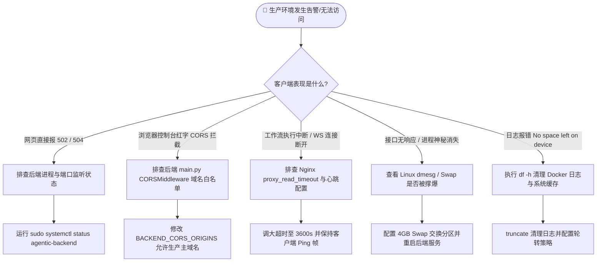

# 06 域名解析、SSL 证书与生产运维排错 SOP

> **适用场景**：系统已完成部署并可以通过 IP 访问，需要正式绑定专属独立域名、配置 HTTPS 加密传输、开启自动续期，以及在生产环境遇到 502/CORS/WebSocket 断连/OOM 等疑难杂症时的排错应急指南。

---

## 目录
1. [一、阿里云域名购买与云解析 DNS 配置](#一阿里云域名购买与云解析-dns-配置)
2. [二、HTTPS 免费 SSL 证书配置实战](#二https-免费-ssl-证书配置实战)
   - [方案 1：Certbot (Let's Encrypt) 自动化签发与自动续期 (强烈推荐)](#方案-1certbot-lets-encrypt-自动化签发与自动续期-强烈推荐)
   - [方案 2：阿里云控制台申请免费 DigiCert 个人证书](#方案-2阿里云控制台申请免费-digicert-个人证书)
3. [三、生产级 Nginx SSL 安全加固配置](#三生产级-nginx-ssl-安全加固配置)
4. [四、生产环境高频故障排查排错大典 (SOP)](#四生产环境高频故障排查排错大典-sop)
   - [故障 1：浏览器报 502 Bad Gateway](#故障-1浏览器报-502-bad-gateway)
   - [故障 2：前端调用报 CORS 跨域错误](#故障-2前端调用报-cors-跨域错误)
   - [故障 3：WebSocket 连接刚建立就中断 (1006 / 60秒断连)](#故障-3websocket-连接刚建立就中断-1006--60秒断连)
   - [故障 4：系统卡死 / Python 进程突然神秘消失 (OOM Killer)](#故障-4系统卡死--python-进程突然神秘消失-oom-killer)
   - [故障 5：ECS 磁盘使用率 100% 导致系统无法写入](#故障-5ecs-磁盘使用率-100-导致系统无法写入)
   - [故障 6：MinIO 图片预览 403 Forbidden 或跨域无法播放视频](#故障-6minio-图片预览-403-forbidden-或跨域无法播放视频)
   - [故障 7：PostgreSQL 连接池爆满 (Too many connections)](#故障-7postgresql-连接池爆满-too-many-connections)

---

## 一、阿里云域名购买与云解析 DNS 配置

### 1.1 域名选购与国内机房 ICP 备案须知

> [!IMPORTANT]
> **关于国内服务器备案的核心常识**：
> 1. 如果你购买的 ECS 服务器地域在**中国大陆境内**（如杭州、北京、上海、深圳）：
>    - 根据工信部要求，域名必须完成 **ICP 备案** 并通过公安联网备案，才能解析到该服务器的 80/443 端口。未备案域名直接绑定境内服务器，会被阿里云白名单拦截，提示“阻断访问”。
>    - 学生实训或临时作业，建议：
>      - **方案 A（无需备案）**：ECS 选购**中国香港（Hong Kong）**或境外节点（如新加坡），域名可直接解析生效，免去备案等待。
>      - **方案 B（IP直连）**：不使用标准 80/443 端口，直接通过 `http://<公网IP>:8002` 搭配 IP 端口形式测试。
> 2. 如果已完成备案或使用香港节点，请继续执行以下步骤。

### 1.2 在阿里云配置 DNS 解析记录

1. 登录 [阿里云控制台](https://hichina.console.aliyun.com/) -> 进入 **云解析 DNS**。
2. 找到你的域名（例如 `yourdomain.com`），点击 **解析设置** -> **添加记录**。
3. 添加两条核心 A 记录：

| 记录类型 | 主机记录 | 解析请求来源 | 记录值 | TTL | 作用说明 |
| :--- | :--- | :--- | :--- | :--- | :--- |
| **A** | `@` | 默认 | `47.98.xxx.xxx` (你的 ECS 公网 IP) | 10 分钟 | 访问根域名 `yourdomain.com` |
| **A** | `ai` | 默认 | `47.98.xxx.xxx` (你的 ECS 公网 IP) | 10 分钟 | 访问子域名 `ai.yourdomain.com` |
| **A** | `oss` | 默认 | `47.98.xxx.xxx` (你的 ECS 公网 IP) | 10 分钟 | MinIO 独立对象存储子域（可选） |

4. **本地验证解析是否生效**：
   在你自己本地电脑的命令行中输入：
   ```powershell
   ping ai.yourdomain.com
   ```
   如果返回的 IP 正是你的阿里云 ECS 公网 IP，说明 DNS 解析已经在全球生效。

---

## 二、HTTPS 免费 SSL 证书配置实战

### 方案 1：Certbot (Let's Encrypt) 自动化签发与自动续期 (强烈推荐)

Let's Encrypt 证书完全免费，通过 Certbot 工具可一键签发，并自带定时任务每 90 天自动静默续期。

#### 步骤 1：在 ECS 上安装 Snapd 与 Certbot

```bash
# 登录 ECS 终端
sudo apt update
sudo apt install -y snapd
sudo snap install core; sudo snap refresh core
sudo snap install --classic certbot
sudo ln -sf /snap/bin/certbot /usr/bin/certbot
```

#### 步骤 2：使用 Certbot 自动化申请并植入 Nginx

> [!NOTE]
> 在执行前，请确保 Nginx 正在运行，且安全组已放行 80 和 443 端口，域名已成功解析到当前 ECS。

```bash
# 执行交互式一键申请与安装 (将 ai.yourdomain.com 替换为你真实的域名)
sudo certbot --nginx -d ai.yourdomain.com

# 交互式提示说明：
# 1. Enter email address: 输入你的常用邮箱 (用于证书即将过期时接收警报)
# 2. Terms of Service: 输入 'y' 同意条款
# 3. Share your email: 输入 'n' 拒绝营销推广
# 4. 稍等 10 秒，Certbot 会自动校验域名的 HTTP-01 Token 并自动修改 Nginx 配置文件！
```

#### 步骤 3：测试证书自动续期 (Auto-Renew)

Let's Encrypt 证书有效期为 90 天。Certbot 在安装时已自动注册了 Systemd Timer 计时器（每天自动巡检两次并在到期前 30 天自动刷新）。

我们可以执行**演练测试**验证是否正常：
```bash
sudo certbot renew --dry-run
```
如果输出 `Congratulations, all simulated renewals succeeded`，代表后续永久免维护，证书到期前会自动静默续期并重载 Nginx！

---

### 方案 2：阿里云控制台申请免费 DigiCert 个人证书

如果你不希望使用 Certbot，也可以使用阿里云官方免费提供的个人测试证书（每年 20 张免费额度）：

1. 登录阿里云控制台，搜索 **数字证书管理服务 (SSL 证书)**。
2. 点击 **免费证书** -> **创建证书** -> **申请证书**。
3. 填入你的域名 `ai.yourdomain.com`，域名验证方式选择 **DNS 验证**（同账号下阿里云会自动添加验证解析，约 1~2 分钟即可完成审核审核下发）。
4. 证书签发后，在列表点击 **下载** -> 服务器类型选择 **Nginx**。
5. 解压下载的压缩包，得到两个文件：
   - `ai.yourdomain.com.pem`（证书公钥）
   - `ai.yourdomain.com.key`（私钥）
6. 将这两个文件上传至服务器目录：
   ```bash
   sudo mkdir -p /etc/nginx/ssl
   # 通过 scp 命令将本地的 pem 和 key 传到服务器:
   # scp ai.yourdomain.com.* root@<ECS_IP>:/etc/nginx/ssl/
   sudo chmod 600 /etc/nginx/ssl/*.key
   ```

---

## 三、生产级 Nginx SSL 安全加固配置

编辑 Nginx 站点配置：
```bash
sudo nano /etc/nginx/sites-available/agentic-commerce.conf
```

贴入经严苛安全加固并完整支持 **HTTP/2、WebSocket 长连接透传、SPA 前端 History 路由、MinIO 素材反代** 的标准配置：

```nginx
# 1. HTTP 80 端口强制 301 重定向到 HTTPS 443
server {
    listen 80;
    listen [::]:80;
    server_name ai.yourdomain.com;

    # Certbot 校验目录放行
    location /.well-known/acme-challenge/ {
        root /var/www/html;
    }

    location / {
        return 301 https://$host$request_uri;
    }
}

# 2. HTTPS 443 生产核心站
server {
    listen 443 ssl http2;
    listen [::]:443 ssl http2;
    server_name ai.yourdomain.com;

    # SSL 证书文件路径 (根据实际方案填写)
    # 如果用 Certbot:
    ssl_certificate /etc/letsencrypt/live/ai.yourdomain.com/fullchain.pem;
    ssl_certificate_key /etc/letsencrypt/live/ai.yourdomain.com/privkey.pem;
    # 如果用阿里云免费证书:
    # ssl_certificate /etc/nginx/ssl/ai.yourdomain.com.pem;
    # ssl_certificate_key /etc/nginx/ssl/ai.yourdomain.com.key;

    # SSL 现代安全加固参数
    ssl_protocols TLSv1.2 TLSv1.3;
    ssl_ciphers 'ECDHE-ECDSA-AES128-GCM-SHA256:ECDHE-RSA-AES128-GCM-SHA256:ECDHE-ECDSA-AES256-GCM-SHA384:ECDHE-RSA-AES256-GCM-SHA384:DHE-RSA-AES128-GCM-SHA256:DHE-RSA-AES256-GCM-SHA384';
    ssl_prefer_server_ciphers on;
    ssl_session_cache shared:SSL:10m;
    ssl_session_timeout 1d;
    ssl_session_tickets off;

    # 安全响应头 (HSTS、防点击劫持、防嗅探)
    add_header Strict-Transport-Security "max-age=31536000; includeSubDomains" always;
    add_header X-Frame-Options "SAMEORIGIN" always;
    add_header X-Content-Type-Options "nosniff" always;
    add_header X-XSS-Protection "1; mode=block" always;

    # 请求体积上限 (允许上传 100MB 以内的高清商品图与视频素材)
    client_max_body_size 100M;

    # ----------------------------------------------------
    # A. 前端单页面应用 (Vue 3 SPA) 静态资源托管
    # ----------------------------------------------------
    location / {
        root /data/agentic-web/dist;
        index index.html;
        # 核心：支持 Vue Router HTML5 History 模式，避免刷新 404
        try_files $uri $uri/ /index.html;

        # 静态资源强缓存优化
        location ~* \.(js|css|png|jpg|jpeg|gif|svg|ico|woff|woff2|ttf|eot)$ {
            expires 30d;
            add_header Cache-Control "public, no-transform";
        }
    }

    # ----------------------------------------------------
    # B. 后端 RESTful API 代理
    # ----------------------------------------------------
    location /api/ {
        # 原生部署填 http://127.0.0.1:8002/api/
        # Docker 部署若在同一主机也是反代到 127.0.0.1:8002/api/
        proxy_pass http://127.0.0.1:8002/api/;
        proxy_http_version 1.1;

        # 保持客户端真实 IP
        proxy_set_header Host $host;
        proxy_set_header X-Real-IP $remote_addr;
        proxy_set_header X-Forwarded-For $proxy_add_x_forwarded_for;
        proxy_set_header X-Forwarded-Proto $scheme;

        # AI 节点执行与生成时间较长，调大超时时间至 600 秒
        proxy_connect_timeout 60s;
        proxy_send_timeout 600s;
        proxy_read_timeout 600s;
    }

    # ----------------------------------------------------
    # C. WebSocket 实时推送透传 (非常关键)
    # ----------------------------------------------------
    location /api/v1/ws/ {
        proxy_pass http://127.0.0.1:8002/api/v1/ws/;
        proxy_http_version 1.1;

        # WebSocket 协议升级标头
        proxy_set_header Upgrade $http_upgrade;
        proxy_set_header Connection "upgrade";

        proxy_set_header Host $host;
        proxy_set_header X-Real-IP $remote_addr;
        proxy_set_header X-Forwarded-For $proxy_add_x_forwarded_for;
        proxy_set_header X-Forwarded-Proto $scheme;

        # 防止 Nginx 默认 60s 未收到数据强行切断长连接
        proxy_read_timeout 3600s;
        proxy_send_timeout 3600s;
    }

    # ----------------------------------------------------
    # D. MinIO 本地对象存储静态素材反向代理
    # ----------------------------------------------------
    location /agentic-assets/ {
        proxy_pass http://127.0.0.1:9000/agentic-assets/;
        proxy_set_header Host $http_host;
        proxy_set_header X-Real-IP $remote_addr;
        proxy_set_header X-Forwarded-For $proxy_add_x_forwarded_for;
        proxy_set_header X-Forwarded-Proto $scheme;

        # 支持多媒体分片与断点续传
        proxy_buffering off;
        proxy_request_buffering off;
        proxy_slice 2m;
    }
}
```

测试并重载 Nginx：
```bash
sudo nginx -t
sudo systemctl reload nginx
```

---

## 四、生产环境高频故障排查排错大典 (SOP)

当系统上线后，如果遇到报错，请严格按照以下标准故障分类进行排查与定位：



---

### 故障 1：浏览器报 502 Bad Gateway

- **现象**：浏览器访问前端页面正常，但在请求 `/api/v1/...` 接口或点击登录时，Network 面板返回 `502 Bad Gateway`。
- **根本原因**：Nginx 网关正常，但后端的 FastAPI/Uvicorn 进程挂了，或者没有监听在 Nginx 配置的 `127.0.0.1:8002`。
- **定位与修复命令**：
  ```bash
  # 1. 检查 8002 端口是否有进程在监听
  sudo ss -tulpn | grep 8002
  
  # 2. 如果是原生部署，检查服务状态与最新日志
  sudo systemctl status agentic-backend.service
  sudo journalctl -u agentic-backend.service -n 50 --no-pager
  
  # 3. 如果是 Docker 部署，检查容器是否处于 Restarting / Exited 状态
  docker ps -a | grep backend
  docker logs --tail 100 agentic-backend-prod
  
  # 4. 常见深层原因：
  # a. 数据库连接串密码配错，后端在启动瞬间抛出 sqlalchemy.exc.OperationalError 崩溃退出。
  # b. 端口被其他旧进程占死，kill 掉后重启服务：
  #    sudo fuser -k 8002/tcp && sudo systemctl restart agentic-backend
  ```

---

### 故障 2：前端调用报 CORS 跨域错误

- **现象**：前端调用接口时，控制台报错：
  `Access to XMLHttpRequest at 'https://ai.yourdomain.com/api/v1/auth/login' from origin 'https://ai.yourdomain.com' has been blocked by CORS policy: No 'Access-Control-Allow-Origin' header is present on the requested resource.`
- **根本原因**：
  1. 后端 `main.py` 中的 FastAPI 中间件未允许该请求源；
  2. 或者请求在到达 FastAPI 前就被 Nginx 报错中断（例如 500/502 错误由 Nginx 抛出，Nginx 默认未携带 CORS 响应头，导致浏览器表现为跨域报错）。
- **定位与修复方法**：
  1. 查看是否是因为后端报错导致的假性跨域（先看 Network 中该请求的真实状态码）。
  2. 检查后端 `main.py` 中的 `CORSMiddleware` 配置，确保包含了生产域名：
     ```python
     # 在 backend/main.py 中检查
     app.add_middleware(
         CORSMiddleware,
         allow_origins=[
             "http://localhost:5173",
             "https://ai.yourdomain.com",  # <-- 必须添加你的生产域名
             "*",                          # 生产环境若允许全开放可临时填 * 测试
         ],
         allow_credentials=True,
         allow_methods=["*"],
         allow_headers=["*"],
     )
     ```
  3. 修改后重启后端服务生效。

---

### 故障 3：WebSocket 连接刚建立就中断 (1006 / 60秒断连)

- **现象**：
  在“营销生成工作台”运行 Agentic 工作流时，任务进行到第 2 个节点时页面断开，控制台提示：
  `WebSocket connection to 'wss://ai.yourdomain.com/api/v1/ws/task_xxx' failed: WebSocket is closed before the connection is established` 或 `code 1006`。
- **根本原因**：
  1. Nginx 默认的 `proxy_read_timeout` 是 60 秒。如果某个 Agent 生成大图或视频耗时超过 60 秒且中间没有下发日志，Nginx 就会强行切断 TCP 连接。
  2. Nginx 配置缺失 `Upgrade` 和 `Connection "upgrade"` 头。
  3. 前端与反向代理协议不匹配（页面是 `https://`，但前端尝试连接 `ws://`，被浏览器安全机制 Mixed Content 阻断）。
- **定位与修复方法**：
  1. 确保前端使用 `wss://`（动态探测协议）：
     ```javascript
     const protocol = window.location.protocol === 'https:' ? 'wss:' : 'ws:';
     const wsUrl = `${protocol}//${window.location.host}/api/v1/ws/${taskId}`;
     ```
  2. 检查 Nginx 中的超时时间是否已调整为 3600 秒：
     ```nginx
     location /api/v1/ws/ {
         proxy_pass http://127.0.0.1:8002/api/v1/ws/;
         proxy_http_version 1.1;
         proxy_set_header Upgrade $http_upgrade;
         proxy_set_header Connection "upgrade";
         proxy_read_timeout 3600s;
         proxy_send_timeout 3600s;
     }
     ```

---

### 故障 4：系统卡死 / Python 进程突然神秘消失 (OOM Killer)

- **现象**：
  当多个用户同时生成营销图文时，服务器 CPU 突然 100%，随后 Uvicorn 进程不留任何错误日志直接消失，`systemctl` 显示 `status=9/KILL`。
- **根本原因**：
  在 2核4G 服务器上，高并发或大体积 Base64 图片在内存中转换时内存耗尽，触发 Linux 内核的 **OOM Killer (Out of Memory)** 机制，系统内核为了防止机器彻底死机，直接 `kill -9` 强制干掉了内存占用最大的 Python 进程。
- **验证命令**：
  ```bash
  # 查看 Linux 内核日志中是否有 OOM 击杀记录
  sudo dmesg -T | grep -i -E "oom|killed process"
  ```
  如果输出类似 `Out of memory: Killed process 12345 (python)`，证实被 OOM 击杀。
- **解决方案**：
  1. **配置 4GB 虚拟内存 Swap（立竿见影救命方案）**：
     ```bash
     sudo fallocate -l 4G /swapfile
     sudo chmod 600 /swapfile
     sudo mkswap /swapfile
     sudo swapon /swapfile
     echo '/swapfile none swap sw 0 0' | sudo tee -a /etc/fstab
     ```
  2. 降低 Uvicorn 并发工作进程数，2核4G 服务器建议配置 `--workers 2`，不要设置成 4 或更高。
  3. 生成的临时图片不要长期存留在内存中，及时转存至 MinIO 并释放局部变量。

---

### 故障 5：ECS 磁盘使用率 100% 导致系统无法写入

- **现象**：
  无法启动服务，执行任何命令报：`No space left on device`，数据库无法写入。
- **根本原因**：
  Docker 容器长时间运行未配置日志轮转，导致 `/var/lib/docker/containers/*/*.log` 膨胀到几十个 GB；或者 Systemd journal 日志占满。
- **定位与清理命令**：
  ```bash
  # 1. 检查各挂载点磁盘占用
  df -h
  
  # 2. 定位哪个目录体积最大
  sudo du -sh /* 2>/dev/null | sort -hr | head -n 5
  
  # 3. 瞬间清空所有正在增长的 Docker 容器日志 (不会中断容器运行)
  sudo sh -c "truncate -s 0 /var/lib/docker/containers/*/*-json.log"
  
  # 4. 清理无用的悬空 Docker 镜像与构建缓存
  docker system prune -af --volumes
  
  # 5. 清理超过 3 天的历史 Systemd 守护进程日志
  sudo journalctl --vacuum-time=3d
  ```

---

### 故障 6：MinIO 图片预览 403 Forbidden 或跨域无法播放视频

- **现象**：
  AI 生成的图片 URL 为 `https://ai.yourdomain.com/agentic-assets/products/...`，但在浏览器中直接打开返回 403 Access Denied。
- **根本原因**：
  MinIO 中创建的存储桶（Bucket）默认为 `Private`（私有访问权限）。
- **解决方案**：
  1. 登录 MinIO 管理控制台（`http://<ECS_IP>:9011`）。
  2. 进入 **Administrator** -> **Buckets** -> 找到 `agentic-assets` 桶。
  3. 进入 **Access Policy**（访问策略），将其从 `Private` 改为 **`Public`** 或添加只读规则：
     - Prefix: `*`
     - Access: `Read-Only`
  4. 或者使用 MinIO Client (`mc`) 命令行直接设为公开：
     ```bash
     docker exec -it agentic-minio mc anonymous set download myminio/agentic-assets
     ```

---

### 故障 7：PostgreSQL 连接池爆满 (Too many connections)

- **现象**：
  后端日志抛出错误：`sqlalchemy.exc.OperationalError: (psycopg2.OperationalError) FATAL: remaining connection slots are reserved for non-replication superuser connections`。
- **根本原因**：
  FastAPI 每次请求创建了 SQLAlchemy session 但未在 `finally` 块中妥善 `close()`，或者 Uvicorn 多进程配置的连接池大小（`pool_size`）相乘后超过了 PostgreSQL 的 `max_connections`（默认 100）。
- **排查与调优**：
  ```bash
  # 连接数据库查看当前活跃连接数
  docker exec -it agentic-postgres psql -U postgres -d dianshang_ai -c "SELECT count(*) FROM pg_stat_activity;"
  ```
  **调优优化方案**：
  1. 修改后端数据库引擎创建参数，限制单进程最大连接数：
     ```python
     engine = create_async_engine(
         DATABASE_URL,
         pool_size=10,         # 基础连接池大小
         max_overflow=20,      # 突发连接最大额外数量
         pool_recycle=1800,    # 30分钟主动回收连接
         pool_pre_ping=True,   # 每次从池中获取连接前先探测有效性
     )
     ```
  2. 提升 PostgreSQL 容器的最大连接数上限：
     在 postgres 启动命令或配置文件中加入 `-c max_connections=300`。

---

## 总结：生产运维日常巡检清单

运维人员每日或发布后应执行的 30 秒健康巡检指令：

```bash
# 一键健康巡检
echo "=== 1. 内存与 Swap 占用 ===" && free -h
echo "=== 2. 磁盘剩余空间 ===" && df -h /
echo "=== 3. 核心端口监听状态 ===" && sudo ss -tulpn | grep -E "80|443|8002|5432|6379|9000"
echo "=== 4. Docker 容器存活状态 ===" && docker ps --format "table {{.Names}}\t{{.Status}}\t{{.Ports}}"
```
若以上巡检全部正常，系统即可长期保持 99.9% 以上的高可用稳定运行！
